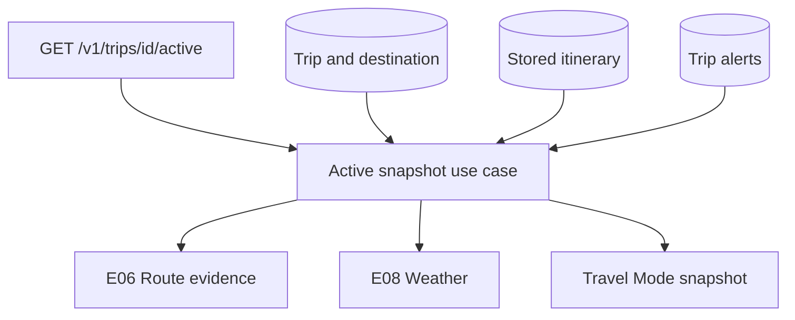

# Active travel runtime

Travel Mode does not display an itinerary. It answers what matters to this traveller right
now, and it refuses to answer what it cannot ground in evidence.



## Destination time, always

Every calculation runs in the destination timezone, loaded from its IANA identifier. Trip
phase, current day and today's schedule are derived from local dates, never from the caller's
clock. An offset string such as `UTC+1` is rejected and falls back to UTC rather than being
parsed by hand.

## The next activity

The next item is the earliest item that has not finished and is not completed, skipped or
cancelled. Array position is never used. An activity already under way is still the next item,
so the app keeps showing it rather than jumping ahead.

## Leave time

```
leaveBy = activity start − route duration − arrival buffer
```

Arrival buffers are typed policy, not scattered numbers.

| Situation | Buffer |
| --- | --- |
| Reserved or reservation-locked item | 15 minutes |
| Transport | 15 minutes |
| Meal | 8 minutes |
| Museum, attraction or experience | 10 minutes |
| Anything else | 5 minutes |

Status follows the remaining time: more than 30 minutes is on time, 5 to 30 is leave soon,
under 5 is leave now, and past the leave time is likely late.

**Without route evidence there is no leave time.** The status becomes `route_unavailable`,
`leaveBy` is absent and `minutesUntilLeave` is negative. The app never shows "leave in 22
minutes" from a guess. The same rule applies when the traveller has not shared a location:
no origin means no route, which means no countdown.

## Partial evidence

A weather outage, a route failure and an alert-store failure each degrade one part of the
response. None of them fails the request. Weather is present only when the provider actually
answered, and it carries its own freshness so the client can show its age.

## Cost of a refresh

Travel Mode refreshes often, so it reads stored itinerary and stored alerts, reuses the cached
weather window from Phase 3, and computes at most one route: the one to the next activity.
There is no provider fan-out per refresh. The response carries `generatedAt` and per-section
freshness so the client can count down locally instead of polling.

## Quick actions

Actions are typed codes with resource identifiers, never URLs. Navigate is enabled only when
the next activity has coordinates; the ticket action is enabled only when a document exists.
The client maps codes to its own navigation.
