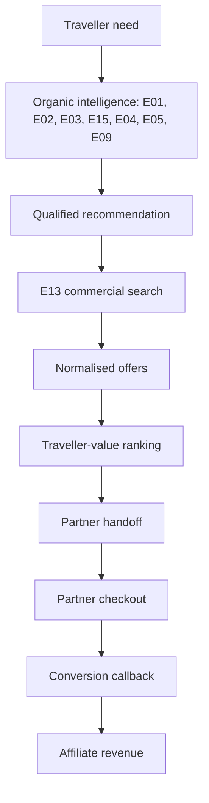

# Commerce

NUVRO earns when it helps a traveller complete a booking they actually wanted. It never
recommends something because that option pays more.

## The order is permanent

Commission enters only at the far right, after every ranking decision is already made.

## Commission cannot reach ranking

This is enforced by types, not by discipline. A traveller-facing `Offer` has no commission
field at all. Commission lives in a separate `Commercials` record that providers return
alongside their offers, and it travels a different path: into the offer cache and then to
attribution. No ranking function takes it as a parameter, so there is no code path by which it
could be read during scoring.

Tests hold the ranking inputs fixed and vary commission from zero to five million minor units.
The ordering is byte-for-byte identical every time. A separate contract test asserts that no
response body contains a commission, payout or tracking field.

The Phase 2 invariant is unchanged: E02 Match Score, E03 destination ranking, E05 itinerary
inclusion, E09 nearby ranking, E12 affordability and E15 feasibility never see commerce data.

## Ranking, per product

Each ranking is versioned so a past result can be explained.

**Flights (`flight-rank-v1`)** score duration, stops, layover burden, the traveller's stated
stop preference, flight-time tolerance, budget, baggage and changeability. A cheap two-stop
eighteen-hour itinerary loses to a slightly dearer direct one.

**Stays (`stay-rank-v1`)** score distance from the itinerary's actual centre of gravity, then
budget, then rating evidence and cancellation terms. Distance keeps discriminating past city
scale, so a hotel seventy kilometres out never ties with one fourteen kilometres out. A
cheaper distant property loses to a well-placed one.

**Activities (`activity-rank-v1`)** score whether the experience fits the traveller's actual
free window, distance, budget, and the E08 weather impact for its own category. A cheap
outdoor experience during a storm ranks below a dearer indoor one.

Every offer carries stable reason codes such as `best_price`, `best_location` and
`fits_itinerary`. Clients localise them; they never parse prose.

## Offers are perishable

Freshness is `live` under five minutes, `recent` under thirty, then `stale`, and `expired`
once the provider's own expiry passes. Only live and recent offers are bookable or rankable.
A stale offer is dropped from results rather than shown as current.

Offers are cached in Redis for twenty minutes keyed by an opaque NUVRO identifier, because
they are inherently short-lived. Conversions and handoffs are durable and live in PostgreSQL.

## Deduplication

The same hotel returned by four affiliates should appear once. Stays deduplicate on property
identity, activities on place identity, flights on a carrier and timing signature, transfers
on mode and duration. Title strings are never used.

## Partner failure

Each partner reports its own status in the response. One partner timing out, being disabled,
or not covering the product leaves the others intact, and a search with no results is an empty
list with a status, never a 500. Partner priority may consider reliability and coverage; it
may never consider commission, and any operational preference must be documented.

## Two money systems, never mixed

| | NUVRO Premium | Travel commerce |
| --- | --- | --- |
| What is sold | NUVRO's own digital subscription | A partner's flight, stay or experience |
| Who takes payment | Apple, through StoreKit | The travel partner |
| Merchant of record | Apple | The partner |
| NUVRO's role | Seller | Referrer |
| Revenue | Subscription | Affiliate commission on eligible bookings |
| Refunds | Apple's process | The partner's process; commission may be reversed |

NUVRO collects no card details, stores no payment methods and is not the merchant of record
for any travel purchase. There is no travel checkout in the product and none is planned for
this phase. A partner refund and a Premium refund are unrelated events in unrelated systems.

## Sponsored placement

Not implemented, deliberately. If it is ever introduced it must be visually labelled, kept
separate from organic results, and must never be presented as a Match Score.
