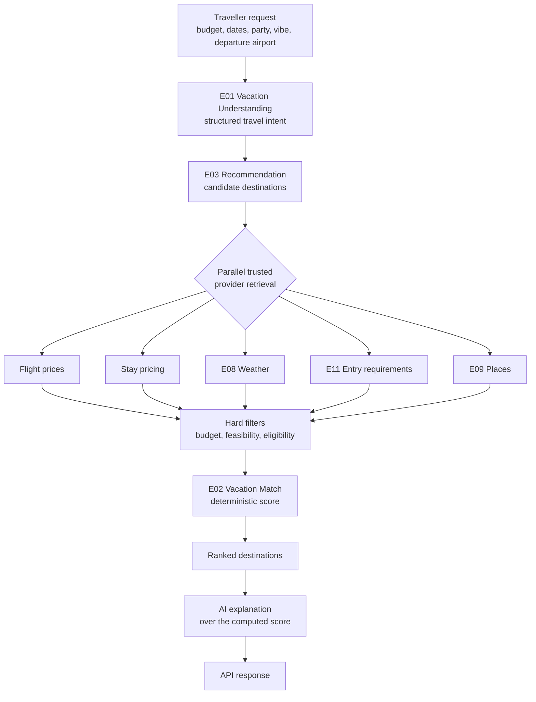

# Data flow

This document describes how a destination recommendation request will flow once the Discover
use case is implemented. It exists now because the ordering it describes is an architectural
invariant, not an implementation choice.

## Recommendation request



## The ordering invariant

The AI explanation step happens **after** canonical scoring, and it receives the score and
the factors that produced it. It never produces the score, reorders the results, or adds a
destination the engine did not rank.

Reversing this order, or letting the model see the candidate set before scoring and return a
ranking, breaks the product. A Match Score that a model invented cannot be explained,
reproduced, audited or defended to a traveller who books a trip on the strength of it.

## Where commerce enters

Commerce attaches to the ranked list, after ranking is complete:

```
ranked destinations  →  E13 Commerce attaches booking options and attribution  →  response
```

Affiliate payout, partner tier and commission never reach the filter or scoring stages. There
is no code path from commerce data into `engine/matching` inputs.

## Concurrency

Provider retrieval is the one stage where concurrency is justified: the calls are genuinely
independent and the latency is additive if run in sequence. Every one of them:

- carries a `context.Context` with a deadline derived from the request
- is cancelled when the request is cancelled or another stage fails fatally
- has an explicit client timeout and a bounded response body
- is retried only when the operation is idempotent

Goroutines are owned by the orchestrating engine or use case. A handler never starts
background work that outlives its request.

## Freshness through the flow

Each provider result carries its observation time and source through filtering, scoring and
into the response. A destination card that shows a price must be able to say when that price
was observed. Values that lose their provenance on the way through cannot be trusted at the
edge.

## Worker flows

Work that must not block a request runs in `cmd/worker` over the same use cases:

```
scheduled trigger  →  use case  →  engines  →  providers  →  PostgreSQL and Redis
```

Examples are price refresh, destination data refresh, alert sweeps, notification delivery,
offline trip pack preparation and affiliate reconciliation. None of them are implemented yet.

## Contract boundary

Released OpenAPI 3.1 produces a generated strict Chi interface. Validation runs before
transport maps DTOs into use-case input. Domain outputs are mapped back into DTOs;
sqlc models stay inside PostgreSQL adapters. See [Phase 1 foundation](phase1-foundation.md).

## Discover intelligence

```
traveller + profile → E01 intent → destination candidates
    → E15 feasibility (entry, flight, cost, FX ports)
    → E02 deterministic match score
    → E03 ranking and optional explanation
    → ranked recommendations
```

Orchestration lives in `usecase/discover`; the engines never call each other. Candidate
evaluation is concurrent with a bounded limit and honours cancellation. Full detail in
[discover-intelligence.md](discover-intelligence.md).

## Destination and itinerary

```
destination → E04 → { E08 weather, E09 places, S01 media } → destination detail
trip → E05 → E09 candidates → E06 route matrix → E08 impact → scheduler → validator → stored itinerary
trip → E12 → category estimates + itinerary activities + booked amounts → trip budget
trip + location → E09 ranking with free time, weather and interests → nearby results
```

Each dynamic section carries its own status and freshness, so one failing provider degrades a
section rather than the response. Full detail in
[destination-intelligence.md](destination-intelligence.md) and
[itinerary-engine.md](itinerary-engine.md).

## Active travel runtime

```
active trip → stored itinerary + one route to the next activity + cached weather + stored alerts
    → snapshot with leave time in the destination timezone
trigger → E07 → conflicts → E09 verified places + E06 routes + E08 impact + E12 delta
    → E05 validator → proposal → traveller approval → atomic versioned apply
worker → deterministic evaluators → fingerprint deduplication → trip_alerts
trip + text → E10 → translation, or an honest unavailable when no provider is configured
```

Leave time exists only where route evidence exists. Full detail in
[active-travel-runtime.md](active-travel-runtime.md) and
[live-replanning.md](live-replanning.md).

## Commerce

```
organic recommendation → E13 partner search → normalised offers
    → traveller-value ranking (commission is not an input) → cached opaque offer
    → server-built handoff against a partner domain allowlist → click recorded once
    → partner checkout → signed webhook → claimed once → normalised conversion
watch → worker → repricer → threshold → Phase 4 alert
```

Commission is carried in a separate record that no ranking function accepts. Full detail in
[commerce.md](commerce.md) and [affiliate-attribution.md](affiliate-attribution.md).

## Personalization

```
observed choice or typed post-trip feedback → signal with strength and time
    → E14 aggregation with per-key decay → threshold and conflict resolution
    → learned preference with confidence, evidence count and explanation code
    → insight the traveller can confirm, dismiss or suppress
    → personalization context (empty when history learning is off)
    → Discover intent, filling only what the traveller left unset
```

Explicit preferences outrank every inference. Engines never read personalization tables.
Full detail in [personalization.md](personalization.md) and
[../privacy/personalization-data.md](../privacy/personalization-data.md).

## Request admission

```
request → per-address token bucket → contract and authentication validation
    → per-traveller token bucket for the route's class
    → idempotency record: replay a recorded creation, refuse a reused key, or run once
    → handler
```

Health probes bypass both buckets. Full detail in
[request-admission.md](request-admission.md).
