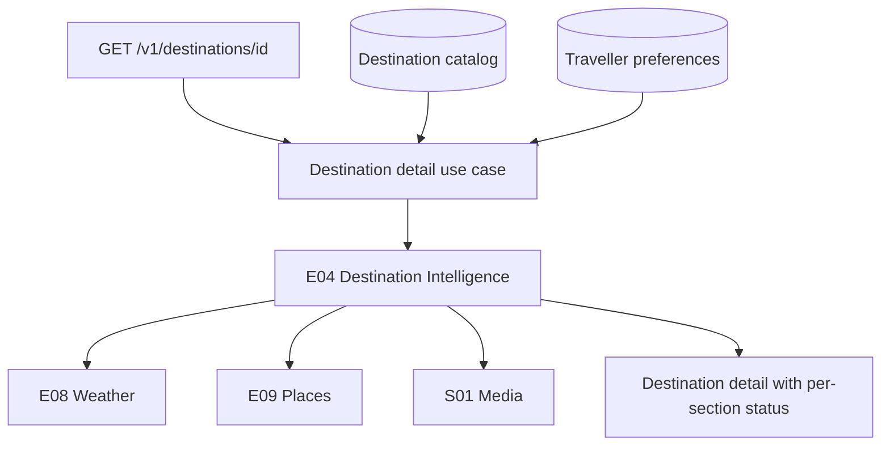

# Destination intelligence

E04 answers one question: what should this traveller know about this place, right now?
It orchestrates trusted evidence. It does not ask a model to describe a destination.

## Flow

E11 entry requirements and E12 budget remain owned by their own engines and are not folded
into this response; the Discover slice already exposes access and affordability separately.

## Sections fail independently

The three dynamic sections run concurrently with a limit of four, and each reports its own
status. A weather outage does not blank the page.

| Status | Meaning |
| --- | --- |
| `available` | Real evidence, with an observation time and a validity window |
| `unavailable` | The source failed or is not configured, and the reason says which |
| `not_applicable` | The question does not apply, such as a trip beyond the forecast horizon |

An empty result is reported as unavailable, never as an available empty section.

## Static against dynamic

The catalog stores only slow-moving descriptive metadata: name, country, timezone,
coordinates, primary airport and tags. Weather, opening hours, photos, ratings and travel
times are dynamic evidence fetched per request and carried with freshness. Nothing dynamic is
written into the destination table.

## S01 media

Selection is deterministic and provider-neutral. A candidate is rejected outright when it has
no attribution, is smaller than 640 by 480, has expired, or is portrait in a landscape
context. Survivors are scored on aspect fit, resolution, alt text and, only when the source
itself labels a season, seasonal relevance. Ties break on the provider reference, so the same
inputs always produce the same photo. Clients receive `MediaAsset` with attribution intact and
never a provider photo resource name.

Attribution is a first-class contract type shared by places and media. Mapping layers never
strip it.
