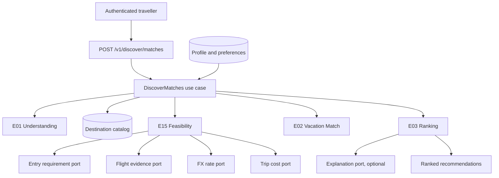

# Discover intelligence

Phase 2 implements the first end-to-end NUVRO intelligence flow: E01 Vacation Understanding,
E15 Travel Feasibility, E02 Vacation Match and E03 Destination Recommendation, behind one
released endpoint.

NUVRO does not answer "where is a popular place to vacation". It answers "given who this
traveller is, where they leave from, the documents they actually hold, the money they
actually have, their dates and what they enjoy, which destinations are genuinely realistic
and attractive for them".

## Flow

## Orchestration decision

The engines are siblings. None imports another. `usecase/discover` owns the sequence:
it builds the intent with E01, loads candidates, and for each candidate calls E15 then E02,
then hands the assembled candidates to E03 for ranking and explanation.

This was chosen over letting E03 call E02 and E15 directly. Ranking is a pure function of
already-computed evidence, so E03 stays testable without provider fakes, and the dependency
graph stays a tree rather than a mesh. E03 receives `[]Candidate`, where each candidate is a
destination, a match score and a feasibility result, all domain types.

Candidate evaluation runs concurrently with a fixed limit of eight, through `errgroup`, so a
large catalog does not spawn one goroutine per destination. Cancellation propagates: if the
traveller abandons the request, in-flight provider work stops.

## E01 Understanding

Builds a `discovery.Intent` from three layers, in strict precedence order:

1. **Request fields.** Anything the traveller supplied for this trip.
2. **Profile.** Persistent residence, passports, departure airport and preferences.
3. **Inference.** Only fills fields still unset after the first two.

An optional free-text query goes to an `Interpreter` port. Its output is normalised, then
validated against the same domain rules as any other input; anything invalid is discarded
silently rather than corrupting the intent. A failing or absent interpreter never fails the
request. Every field records its provenance in `Intent.Sources`, so it is possible to say
whether a value came from the request, the profile or inference.

No AI provider is configured, so today the interpreter is absent and the flow is fully
deterministic. The engine imports no provider package.

## E15 Feasibility

Answers three separate questions and never collapses them.

**Access.** For each passport the traveller holds, E15 asks the entry port and keeps the
strongest result, recording which document produced it. With no passport, access is
`unknown` with the reason `passport_context_required`; it is never assumed. Statuses are
`easy`, `manageable`, `preparation_required`, `not_feasible` and `unknown`. The raw legal
entry mode is kept separately, so an eVisa with low preparation can still read as easy
without hiding what it is. No entry rule is hardcoded and no country matrix exists in the
codebase.

**Affordability.** Compares the traveller's budget to a cost range from the cost port. If the
estimate is in another currency, it is converted through the FX port and the conversion is
returned with its rate, source and observation time. Without a rate, the status is
`insufficient_evidence`; a cross-currency estimate is never guessed. Statuses are
`strong_fit`, `good_fit`, `tight`, `over_budget` and `insufficient_evidence`. The traveller's
currency is always what the response reports.

**Flight.** Summary evidence only: availability, stops, duration and an optional price.
Detailed offers belong to the later Flights feature. A failing provider yields `unknown`, a
provider that reports no route yields `unavailable`, and those two are treated differently
everywhere.

Overall feasibility is `strong`, `viable`, `challenging`, `not_feasible` or `unknown`,
computed deterministically from the three above. Transit risk is modelled and reported as
`unknown` until a provider supplies connection evidence; safe transit is never assumed.

## E02 Vacation Match

Deterministic, versioned, explainable. Version `match-v1` distributes exactly 100 points:

| Component | Points |
| --- | --- |
| Interests | 25 |
| Budget | 20 |
| Weather | 15 |
| Access | 15 |
| Crowds | 10 |
| Flight | 10 |
| Pace | 5 |

A configuration test asserts the weights total 100. Every component returns awarded points,
possible points, an assessment and a stable explanation code, so a score can be reconstructed
from its inputs. The paperwork preference changes how access is scored: a traveller who asked
to keep it simple loses more points for a destination needing preparation.

Unknown evidence scores as partial credit, never as zero and never as full. Known-bad
evidence, such as a route that does not exist, scores zero. An LLM never produces the number.

## E03 Ranking

Excludes candidates whose feasibility is `not_feasible`, then orders by, in order:

1. Personal match score, descending.
2. Overall feasibility rank, descending.
3. Access rank, descending.
4. Expected-cost-to-budget ratio, ascending; a known ratio outranks an unknown one.
5. Destination identifier, ascending.

The final tie-break makes the order total, so the result never depends on map iteration.
Reasons are stable machine codes such as `easy_entry`, `within_budget` and `direct_flight`;
clients localise them rather than parsing prose. A deterministic summary is generated for
every recommendation; if an explanation generator is configured, it may replace only the
summary text, never a score, status, or rank.

## Commerce independence

E02 receives an intent, a destination catalog record and a feasibility result. There is no
path from commerce to any of them. A test scores the same destination with and without
commercial-looking metadata and asserts the score is identical.

## Fairness

Passport and residence are used only because they determine travel logistics: which documents
are needed and how far the traveller is flying. There is no branch anywhere on a specific
country. The identical algorithm runs for every traveller, which the Nigeria, United States,
dual-passport and no-passport fixtures exercise against one shared catalog.
