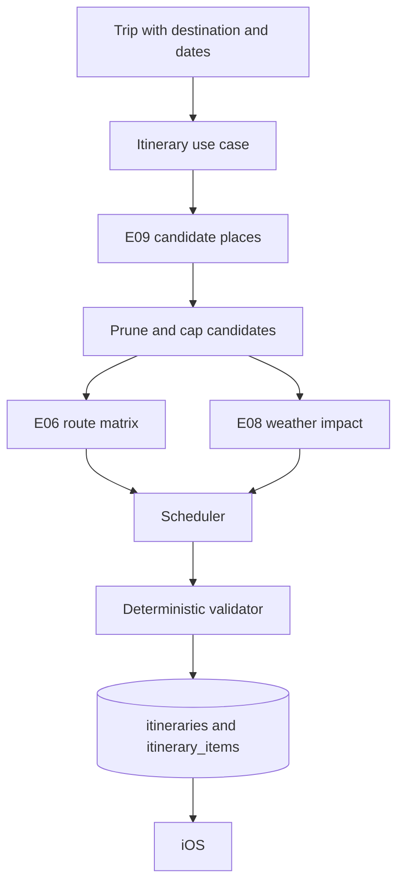

# Itinerary engine

E05 builds a day-by-day plan that is possible in reality. A model may later describe a plan,
but only deterministic validators decide whether one is valid.

## Flow

## Candidate pipeline

Traveller interests become place categories, which become one nearby search. Results are
pruned before any routing: invalid records and places already known to be closed are dropped,
then the pool is ordered by interest match, then rating, then identifier, and capped at 24.
Only that capped pool enters the route matrix, which is itself capped at 12 points.

## Scheduling

Each pace defines a shape rather than a hard-coded density.

| Pace | Activities per day | Buffer | Day window |
| --- | --- | --- | --- |
| Relaxed | 2 | 45 minutes | 10:00 to 19:00 |
| Balanced | 3 | 30 minutes | 09:00 to 20:00 |
| Packed | 4 | 15 minutes | 08:00 to 21:00 |

Days are built in the destination timezone using its IANA identifier, never a fixed offset.
The scheduler places a candidate only when the slot still fits after adding the route time
from the previous stop plus the buffer, the place is not closed at that hour, and the weather
impact for that category is not high. A candidate that fails any of these is skipped, not
squeezed in.

Locked items are carried through untouched and are scheduled around, never over.

## Validation

The validator returns structured violations, never a bare failure.

| Code | Raised when |
| --- | --- |
| `overlapping_items` | Two items on one day overlap |
| `travel_time_not_feasible` | The gap is smaller than the known route time plus buffer |
| `outside_trip_dates` | An item falls outside the trip window |
| `place_closed` | Known opening hours exclude the scheduled time |
| `weather_blocked` | The activity carries a high weather impact |
| `place_not_resolved` | An activity has no resolved place |
| `invalid_item` | The item fails its own domain rules |
| `locked_item_moved` | A locked item's times changed |

Unknown evidence is never treated as failure. An unknown route or unknown opening hours
produce no violation; only known-bad evidence does.

## Grounding

Every generated activity carries a resolved place identifier. If a suggestion cannot be
resolved through E09, it is dropped rather than shown. There is no path by which an invented
establishment reaches an itinerary.

## Persistence

One itinerary per trip, enforced by a unique constraint on the trip. Regeneration deletes
unlocked items, keeps locked ones, inserts the new plan and advances the version. Items are
rows with typed columns, not a JSON blob. Database checks enforce that an item ends after it
starts and that status, kind, source and mode stay inside their vocabularies.
