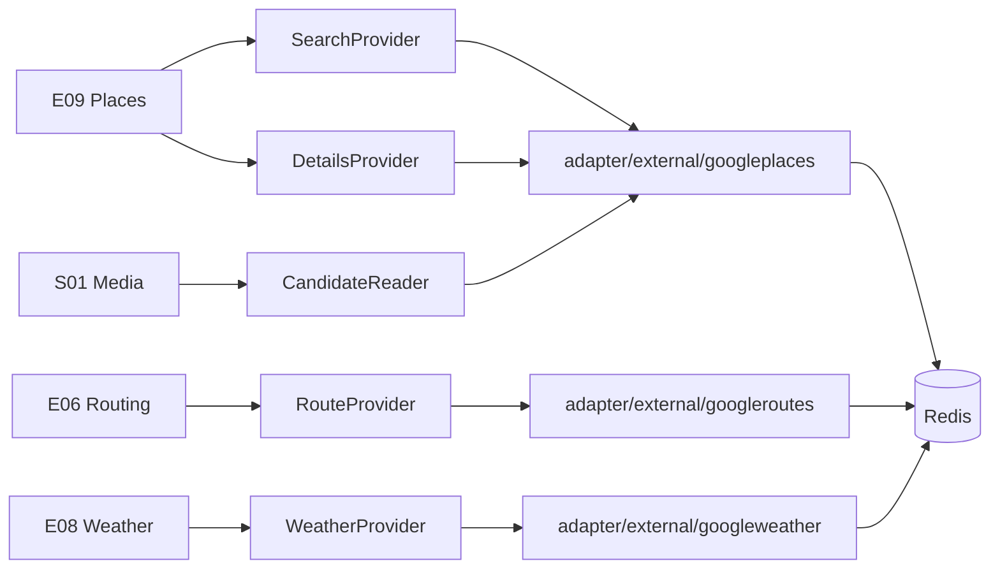

# Live provider flow

Phase 3 introduces the first real external integrations. Google is an implementation detail
behind consumer-owned ports; no engine imports a provider package.

## Unconfigured behaviour

With `GOOGLE_MAPS_API_KEY` unset, no adapter is constructed and every engine reports honest
unavailability. Destination sections read `unavailable`, weather reads `unavailable`, routes
read `unavailable` with no duration, itinerary generation fails with a clear message rather
than producing a fictional plan, and the budget returns no estimate. Nothing is invented and
nothing panics.

## Safety

Every provider call takes a context, a configured timeout, and a bounded response read. HTTP
statuses map to safe errors: 429 becomes rate limited, 401/403 and 5xx become unavailable, and
an unparseable body becomes malformed. Provider error text never reaches a client. The API key
travels in a header for Places and Routes and in a query parameter for Weather, and no
provider URL is ever logged.

## Caching

Each capability owns its keys under `nuvro:v1:<capability>:<digest>`. The digest is a hash of
the query, so no user data or coordinates appear in a key.

| Cache | Lifetime | Reasoning |
| --- | --- | --- |
| Nearby search | 15 minutes | Results shift with opening status |
| Place details | 6 hours | Names and coordinates move slowly |
| Weather window | 1 hour | Forecast refresh cadence |
| Walking and cycling routes | 24 hours | Not traffic dependent |
| Driving and transit routes | 10 minutes | Traffic dependent, keyed by departure hour |
| Media selection | 6 hours | Keeps a destination's photo stable for a viewer |

Only usable evidence is cached. An unavailable route, an unavailable weather window and an
empty place list are never stored, so a provider outage cannot be frozen in place. Redis loss
costs latency, never correctness.
