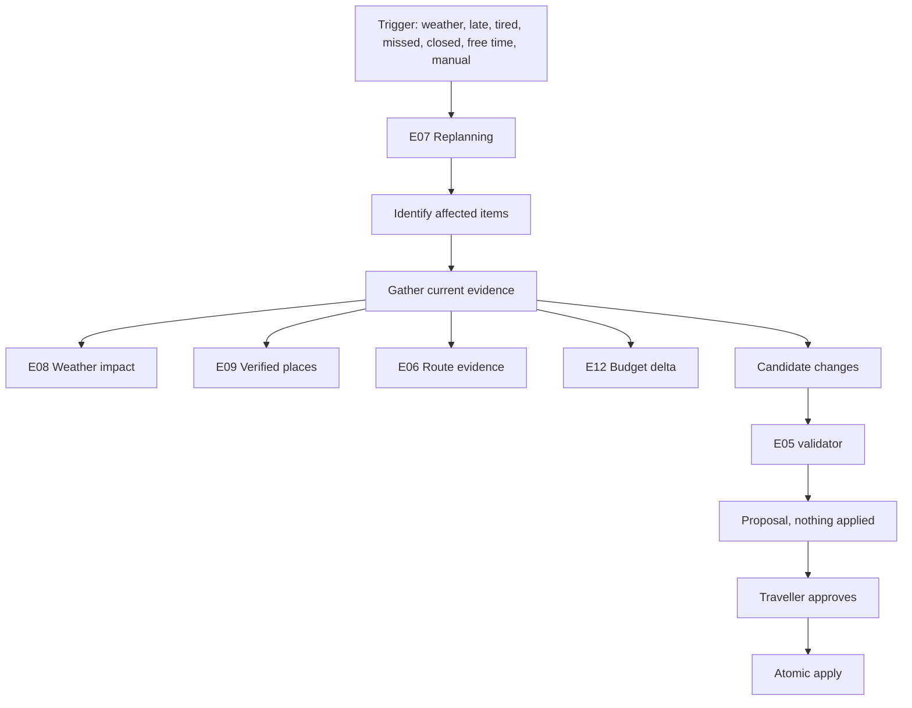

# Live replanning

E07 answers one question: what is the smallest useful change that fixes this problem?

## Propose, then apply

A proposal never changes stored state. `POST /v1/trips/{tripId}/replan` returns changes,
reasons, preserved constraints and a budget delta. Only
`POST /v1/trips/{tripId}/replan/{proposalId}/apply` writes, and only when the traveller asks.

## Minimal change

The engine looks only at items inside the affected window that are not locked and not already
finished. For each conflict it prefers, in order: replace the activity in the same slot with a
verified alternative; move it to a later free slot within three days; remove it. At most four
changes are proposed. A seven-day trip is never rebuilt because one afternoon rained.

## Preserved constraints

| Constraint | How it is honoured |
| --- | --- |
| Locked items | Skipped during conflict identification, and re-checked at apply |
| Reservations | A reserved item is locked by default |
| Trip dates | Slot search never leaves the itinerary's day range |
| Budget ceiling | Reported as an explicit delta, never silently exceeded |
| Accessibility | Reduced walking caps candidate distance and switches the travel mode |
| Travel pace | Reported as preserved when the traveller has a stated pace |

Constraints actually applied are listed on the proposal, so the client can show what was
protected.

## Triggers

| Trigger | What it looks for |
| --- | --- |
| `weather` | Items whose E08 impact for their category is high |
| `closed` | Items whose place evidence says closed |
| `late`, `missed` | Items whose start time has already passed |
| `tired` | The last flexible activity of a day with more than one |
| `free_time`, `manual` | Traveller-initiated; free text may refine the trigger |

## AI cannot manufacture reality

An optional interpreter may read a message like "we're exhausted" and return a trigger,
categories and a pace hint. Its output is validated: an unknown trigger or an invented place
category is discarded entirely and the request proceeds deterministically. Every replacement
place comes from E09, so an unresolvable suggestion can never enter an itinerary. The engine
works with no interpreter at all.

## Validation and apply

Every proposal is run through the E05 validator before it is returned; `valid` and the
violation list are part of the response. Apply re-checks everything: the proposal belongs to
the trip, is not already applied, has not expired, was built on the current itinerary version,
does not move a locked item, and still produces a valid plan. The write itself bumps the
version and replaces items inside one transaction, so a concurrent change causes a conflict
rather than a silent overwrite.

Proposals live for two hours. A rain suggestion made at 14:00 cannot be applied at 19:00.

## Audit

Applied proposals are stored in PostgreSQL with their changes, reasons, preserved constraints,
budget delta, who applied them and when. Redis was considered and rejected for this: applied
history must survive a cache eviction. No model reasoning is stored, only the structured facts.
