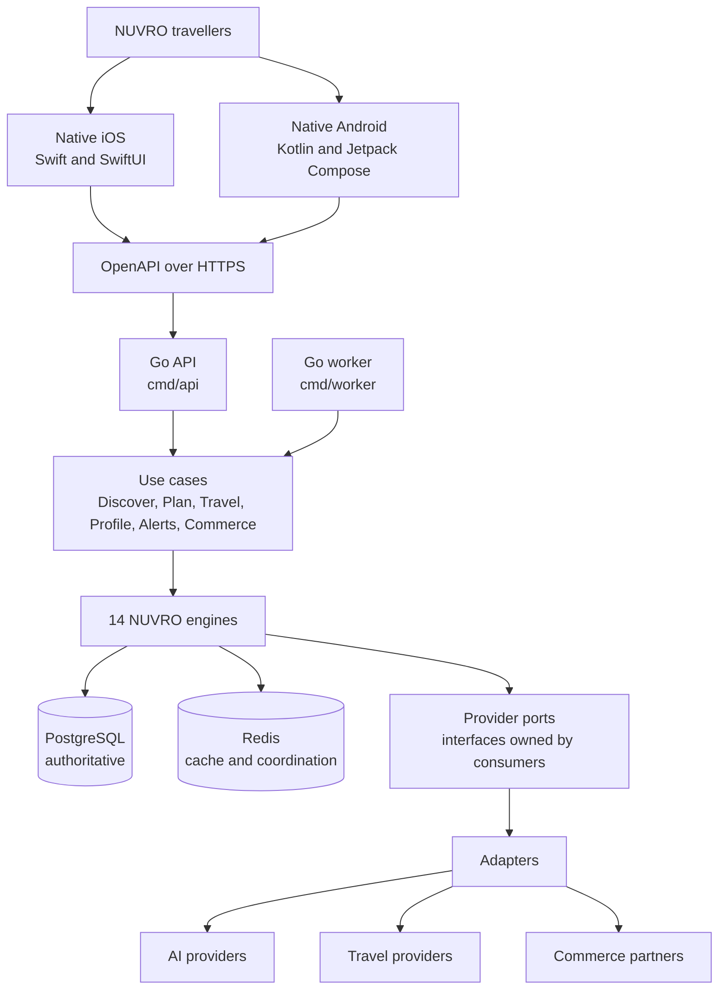

# Architecture overview

NUVRO is a native iOS and native Android product served by a Go backend, sharing one OpenAPI
contract. The backend is a modular monolith with strong package boundaries, not a set of
microservices.

## System



The engines never import a concrete provider. They declare the narrow interfaces they need,
and adapters in `internal/adapter/external` implement them. The composition root in
`internal/app` is the only place that knows which implementation is wired in.

## Layers

```
domain  ←  engine  ←  usecase  ←  transport
```

| Layer | Location | Responsibility |
| --- | --- | --- |
| `domain` | `backend/internal/domain` | Travel vocabulary and invariants. Standard library only. |
| `engine` | `backend/internal/engine` | The 14 capability boundaries. Scoring, orchestration, rules. |
| `usecase` | `backend/internal/usecase` | Product operations that compose engines and ports. |
| `transport` | `backend/internal/transport` | HTTP decoding, validation, error mapping, response shaping. |
| `adapter` | `backend/internal/adapter` | PostgreSQL, Redis, queue and external provider implementations. |
| `platform` | `backend/internal/platform` | Configuration, logging, telemetry, clock, identifiers. |
| `app` | `backend/internal/app` | Composition root. Wires everything and owns process lifecycle. |

Detail and the enforced forbidden edges are in [dependency-rules.md](dependency-rules.md).

## Processes

Two binaries share one module, one set of use cases and one domain.

| Binary | Purpose |
| --- | --- |
| `cmd/api` | Serves the OpenAPI contract over HTTP. Never blocks a request on slow background work. |
| `cmd/worker` | Runs work that must not block a request: price refreshes, alert sweeps, destination data refresh, heavy AI orchestration, offline trip pack preparation, affiliate reconciliation. |

Both are thin. They load configuration, build the application through `internal/app`, and
handle `SIGINT` and `SIGTERM` by cancelling a context. The API drains in-flight requests
within the configured shutdown grace period.

## Storage

PostgreSQL is the authoritative transactional store, accessed through pgx/v5 with SQL written
by hand and compiled by sqlc. There is no ORM.

Redis is ephemeral. It may hold destination, weather and price caches, rate limit state,
short-lived session and trip state, distributed coordination and queue state. Critical trip
or account information is never stored only in Redis. Every cache entry has a namespaced key,
a clear owner, a TTL where appropriate and an invalidation strategy.

## Observability

Structured logs use `log/slog`. Every request receives a server-issued identifier that is
returned on the response, attached to log records, and included in error envelopes so a
traveller support ticket can be traced to a request.

OpenTelemetry traces and metrics are the instrumentation boundary and live under
`internal/platform/telemetry`. A recommendation request fans out to many providers, so a
trace must show the shape of the work:

```
request
├── understanding
├── flights
├── weather
├── stays
├── requirements
├── matching
└── AI explanation
```

Passport data, tokens, credentials and unnecessary personal data never reach a log, trace,
metric or error envelope.

## Architecturally significant dependencies

| Dependency | Why |
| --- | --- |
| `github.com/go-chi/chi/v5` | Routing and HTTP composition over `net/http`. Nothing more. |
| `golang.org/x/sync` | `errgroup` for bounded, cancellation-aware concurrency in the worker. |
| `gopkg.in/yaml.v3` | Test-only. Lets contract tests read the OpenAPI documents so the API and the contract cannot drift. |

Phase 1 adds pinned pgx/v5/pgxpool, go-redis, Goose, sqlc, oapi-codegen,
kin-openapi/nethttp-middleware, and OpenTelemetry trace/metric SDKs. These implement
the requested contract, persistence and observability foundation; no external travel
SDK is installed. See [Phase 1 foundation](phase1-foundation.md) and [API overview](../api/overview.md).

## Future extraction points

These are documented decisions, not omissions.

| Candidate | Condition for extraction |
| --- | --- |
| An engine becoming a service | Operational evidence: an isolation, scaling or failure-domain problem the monolith cannot solve. |
| A Python or PyTorch learned ranking subsystem | Enough proprietary behavioural data to beat deterministic ranking, plus its own decision record. There is no `ml/` directory today because nothing justifies one. |
| Terraform, Kubernetes or Helm | A chosen cloud deployment target. See `infra/README.md`. |
