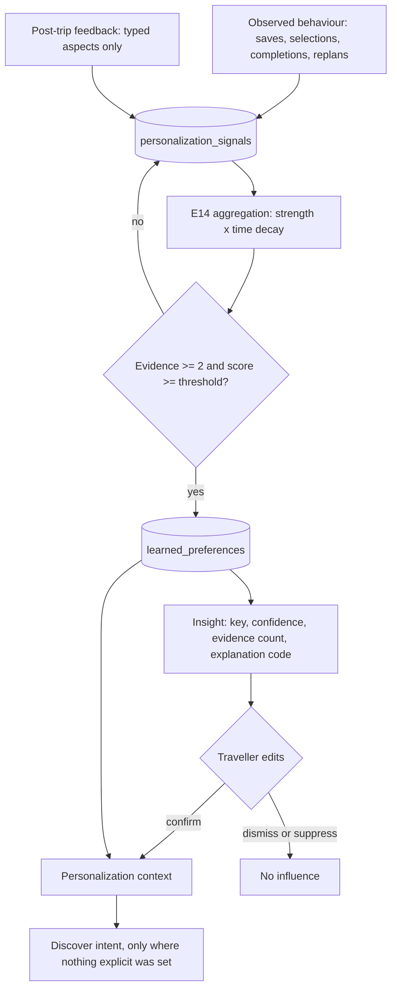

# Personalization and learning

E14 makes NUVRO feel like it remembers a traveller without ever becoming an opaque profile.
Everything it learns is explainable in one sentence, editable in one tap, and revocable in
one switch. No model is trained. No trait is guessed.

## What the traveller told us is not what we inferred

Two vocabularies exist and they never merge.

Explicit preferences live in `traveler_preferences`. The traveller set them; they are facts.
Learned preferences live in `learned_preferences`. NUVRO derived them from observed choices;
they are inferences carrying a confidence, an evidence count and an explanation code.

When both speak to the same question, explicit wins, always. The precedence is a number, not
a convention: explicit carries weight 100, a confirmed inference 60, and an unconfirmed
inference between 8 and 35 depending on confidence. A traveller who set a relaxed pace in
their profile keeps it no matter how many packed itineraries they book.

## The flow

Nothing crosses from `learned_preferences` into a recommendation without passing through the
context, and the context is empty whenever history learning is off.

## Signals, strength and decay

A signal records that something happened, not who the traveller is. It carries a type, a
subject, a subject value, a strength and a time. Strength follows the cost of the action:
an explicit confirmation or typed feedback is strong (weight 6), a selection or a completed
activity is medium (3), a save or a browse is weak (1).

Weight decays with age so that a taste from four years ago cannot outvote last month. Decay
is a halving function over a half-life that depends on what is being learned. Interests
change slowly, so they use a 365-day half-life. Pace and transfer tolerance change with life
circumstances, so they use 60 days.

A preference is only created when at least two independent pieces of evidence exist and the
decayed score clears the medium threshold. One save is never a personality.

## Conflicts resolve, they do not accumulate

Some keys are mutually exclusive: a quiet neighbourhood against a central one, a relaxed
pace against a packed one. When both cross the threshold, the weaker score is dropped rather
than both being applied. A traveller is never told NUVRO learned two opposite things.

## Editing is real, not cosmetic

Every insight is editable. Confirming promotes it to explicit-adjacent weight. Dismissing
removes its influence permanently: the aggregation writes back only over rows whose status
still influences, so a later burst of signals cannot resurrect a dismissed inference.
Suppressing silences it for a window without deleting the evidence.

Turning history learning off empties the learned half of the context entirely at read time,
without deleting anything, so the switch is instantly reversible. Clearing learning deletes
the signals and the learned preferences and leaves the explicit profile and the trips alone.

## Insights are codes, not sentences

The API returns a `summaryCode`, a `key`, a confidence, an evidence count and structured
parameters. The client renders the copy. English strings are never persisted as canonical
truth, so the same learning reads correctly in any language NUVRO later supports.

## Where personalization is allowed to act

Only at the intent boundary, in `usecase/discover`, and only to fill gaps. A learned interest
is added when the traveller did not name it. A learned pace applies only when the request
carries no pace. Engines never query personalization tables; they receive an intent and rank
it. This keeps ranking deterministic and reviewable, and it means a personalization failure
degrades to an ordinary unpersonalized result rather than an error.

Commission is not in this picture at any point. See [commerce.md](commerce.md).

## What is deliberately absent

No embedding store, no vector database, no trained model, no free-text mining. Feedback is a
closed set of typed aspects, which is why it can be aggregated without reading prose about a
traveller's life. Data handling is described in
[../privacy/personalization-data.md](../privacy/personalization-data.md).
