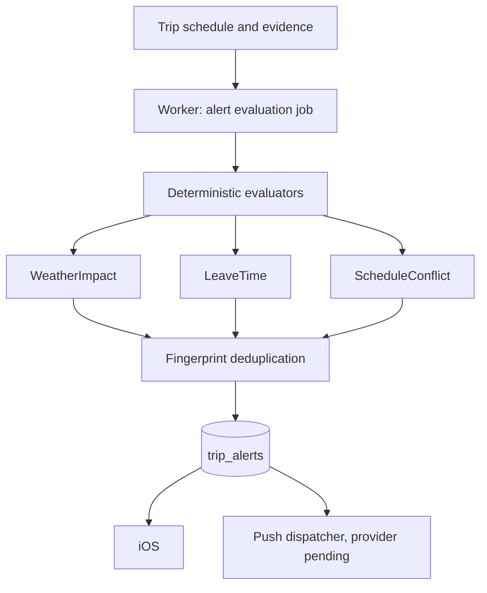

# Smart alerts

Trip alerts identify meaningful changes to a trip. They are not notifications for their own
sake, and nothing here is a marketing channel.

## Deterministic evaluators

Each evaluator is a small independent unit. There is no alert service with a switch statement,
and no model decides whether it is raining or whether two activities overlap.

**WeatherImpact** fires only when E08 rates an upcoming activity's impact as moderate or high
for its own category. A museum is not flagged for rain. Clear weather produces nothing. An
unavailable forecast produces nothing rather than a guess.

**LeaveTime** fires within 45 minutes of the leave time, and only when route evidence exists
and the status is not on time. Without a route there is no reminder.

**ScheduleConflict** reuses the E05 validator and reports overlaps, infeasible travel and
closures, but only for items that have not already finished.

## Deduplication

Every alert carries a fingerprint over trip, type, related resource and an evidence window.
Message text is never part of it. A weather conflict evaluated every five minutes produces one
row, because the window is the activity hour plus the impact level. A leave reminder buckets
the remaining time in 15-minute steps, so ten evaluations produce at most two reminders. The
database enforces this with a unique constraint on trip and fingerprint; a repeat evaluation
refreshes severity and freshness in place.

## Severity and lifecycle

Severity is `info`, `attention` or `important`. There is deliberately no `critical`: nothing
here is an emergency, and making every alert red would make none of them useful.

Status moves forward only: unread to read to resolved. A client cannot mark an alert expired,
reopen a resolved one, or edit its facts. Expiry is applied server-side from `expiresAt`
before any listing.

## Copy stays out of the database

An alert stores a title code and structured message data, never formatted English. Rendering
and localisation belong to the client. Timestamps are returned as timestamps, not as "10:00 AM".

## Worker scheduling

The job runs on an interval, defaulting to five minutes and configurable between one minute
and one hour. It queries only trips that are upcoming or active, have an itinerary, and whose
dates overlap the next twelve hours. It does not scan every user, and it does not poll every
minute. Each evaluation is an ordinary function call, so the whole pipeline is unit-testable
without waiting on wall-clock time.

## Push

The dispatcher is provider-neutral: a `Sender` and a device `Registry` behind an interface. No
APNs adapter exists, because no certificate is configured, so the dispatcher reports itself
unconfigured and canonical alerts are still stored and served. Payloads deliberately carry only
a title code, severity, action and collapse identifier, so a lock screen never leaks itinerary
detail. Device token storage is deliberately not built yet; it belongs with the adapter.
