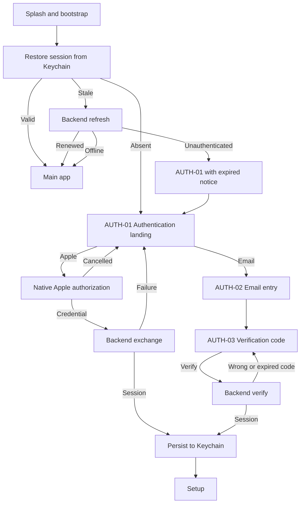

# iOS authentication flow

Authentication is a supporting flow outside the numbered travel screens. It appears after
onboarding whenever no valid session can be restored. There is no password anywhere in NUVRO:
the two methods are Sign in with Apple and a passwordless email code. Both create an account or
sign a returning traveller in; the client never distinguishes the two.

## Screens

| Screen | Purpose | States |
| --- | --- | --- |
| AUTH-01 Authentication landing | Wordmark, tagline, native `SignInWithAppleButton`, "Continue with Email", legal line | idle, authenticating, Apple failure, backend failure, expired session notice, signed-out notice, deleted-account notice |
| AUTH-02 Email entry | One email field, native keyboard and content type, single submit | pristine, editing, invalid format after editing ends, submitting, rejected, rate limited, offline, unavailable |
| AUTH-03 Verification | One semantic code field with one-time-code AutoFill, six visual digits, resend with backend cooldown, change email | entering, verifying, wrong code, expired code, resending, rate limited, verified |
| AUTH-04 Failure and retry | Inline failure card reused on all three screens; retry re-runs the failed operation | retryable and non-retryable failures |
| Bootstrap | Branded restoring state shown instead of flashing sign-in before the main app | restoring |

## Client architecture

`NuvroAuthentication` owns the flow. The app target injects concrete pieces.

| Type | Role |
| --- | --- |
| `AuthenticationClient` | Protocol for the backend exchange: Apple credential, email code request, verification, refresh, sign out, delete account. Typed errors through `AuthenticationFailure`. |
| `PendingAuthenticationClient` | The production placeholder. Every call fails with `unavailable` until the backend contract below exists. It never pretends. |
| `PrototypeAuthenticationClient` (app target) | Prototype fixture used by the demo build alongside the other `Prototype*` content. Issues local sessions instantly and rejects the code `000000` so the failure path is visible. |
| `SessionStore` | Protocol; `KeychainSessionStore` is production (generic password, after-first-unlock, this device only); `InMemorySessionStore` serves tests and previews. |
| `AuthenticationCoordinator` | `@Observable` state machine: `unknown → signedOut / signedIn / refreshing / authenticating / expired`. Restore, Apple completion, email establish, sign out, delete. |
| `AppleAuthorizationMapper` | Maps `ASAuthorization` into `AppleCredential`; `ASAuthorizationError.canceled` becomes `.cancelled`, which is not an error. |
| `EmailEntryModel`, `EmailVerificationModel` | Form state, double-submit guard, digit sanitising, backend-driven resend cooldown. |

Rules the code enforces:

- The app never decides an Apple credential is valid. The credential is sent to the backend and the
  backend's session is what gets stored. No JWT is decoded on the client.
- Apple may return a private relay address and may omit name and email on later authorizations;
  `AppleCredential` keeps both optional.
- Session descriptions redact tokens. Nothing in the module logs a token, code, or email.
- A refresh that fails because the network is down keeps the stored session usable. Only an
  `unauthenticated` answer from the backend expires it. Local trip state is never erased by expiry.
- Sign out clears the Keychain even if the backend call fails; app preferences on the device stay.
- Delete account is a three-step flow (explainer sheet, destructive alert, backend call) and only
  reports success when the backend confirms.
- Code length and resend cooldown come from the backend's `EmailCodeRequest`, never from constants
  scattered in views.

## Contract gap report

`contracts/openapi/openapi.yaml` declares only `/health/live` and `/health/ready`. None of the
authentication operations exist in the contract yet, so the client is wired behind the
`AuthenticationClient` protocol and the production implementation reports unavailable.

Proposed operations, to be promoted through OpenAPI before production wiring:

| Operation | Purpose | Notes |
| --- | --- | --- |
| `POST /v1/auth/apple` | Exchange an Apple identity token and authorization code for a NUVRO session | Backend verifies with Apple; response is `AuthSession` |
| `POST /v1/auth/email/code` | Request a verification code | Response carries `masked_email`, `code_length`, `resend_after_seconds` |
| `POST /v1/auth/email/verify` | Verify a code and issue a session | `404` maps to invalid code, `409` to expired code |
| `POST /v1/auth/refresh` | Renew a session from its refresh token | `401` expires the client session |
| `POST /v1/auth/logout` | Revoke the session | Client clears local state regardless |
| `DELETE /v1/me` | Delete the account | Must be confirmed by the backend before the client signs out |
| `PUT /v1/me/travel-profile` | Save the Travel Setup answers (`TravelProfile` schema) | Feeds E15 Travel Feasibility; the client stores a local copy for offline display only |
| `GET /v1/me/travel-profile` | Load the profile on a new device | Replaces the local copy |

The `AuthSession` shape the client already decodes is `access_token`, `refresh_token`,
`expires_at` (RFC3339) and `account_id`. A future magic-link verification can reuse
`POST /v1/auth/email/verify` with a link token instead of a typed code without changing the
module's state machine.
